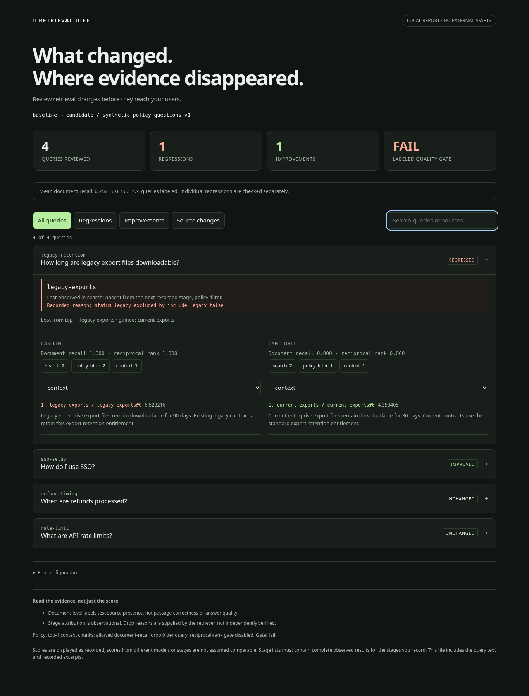

# Retrieval Diff

[](https://github.com/Sampsonyu/retrieval-diff/actions/workflows/ci.yml)

**Find the recorded stage where your RAG evidence disappeared.**

Compare two retrieval runs, inspect the search → filter → context funnel, and
export an interactive HTML report that opens locally. No API keys, model calls,
database, or runtime dependencies.



Status: **working first version, seeking real-world validation**. The included
demo is synthetic. Adoption, production reliability, and performance on your
workload have not been established. The distribution name is provisional; this
project is not published on PyPI.

## The problem

A retrieval change can improve one question and break another while the average
score stays the same. A final list of retrieved chunks cannot tell you whether a
missing source was never found, filtered out, or dropped from the context budget.

Retrieval Diff makes the recorded evidence reviewable:

- **Per-query gates:** one improvement does not cancel another query's regression.
- **Stage-aware diagnosis:** see the last stage that contained a missing source,
  the next recorded stage that did not, and any removal reasons you recorded.
- **Portable review:** a searchable, filterable HTML file with side-by-side stages,
  text excerpts, configuration, and metrics. No hosted account or external assets.
- **Honest uncertainty:** no labels means changes only; missing instrumentation
  means the cause is unknown. Document presence does not prove answer correctness.

## Run the demo

Python 3.10+; install from this checkout:

```sh
git clone https://github.com/Sampsonyu/retrieval-diff.git
cd retrieval-diff
python -m venv .venv
. .venv/bin/activate
python -m pip install -e .
python examples/build_demo.py
retrieval-diff compare artifacts/demo/baseline.json artifacts/demo/candidate.json \
  --k 1 --require-labels \
  --html artifacts/demo/report.html \
  --json artifacts/demo/report.json \
  --markdown artifacts/demo/report.md
```

The comparison **intentionally exits 1**: a stricter status filter loses a legacy
customer's entitlement. Acronym expansion fixes a different question. The mean
document recall stays at **0.75**, but the per-query gate catches the regression.
These numbers describe only the checked-in synthetic BM25 experiment.

Open `artifacts/demo/report.html` in your browser. Select **Regressions**, expand
the query, then select a recorded stage on either side. The report shows the
relevant source disappearing between `search` and `policy_filter`, with the
instrumented reason `status=legacy excluded by include_legacy=false`.

Now preserve the legacy entitlement while keeping the acronym improvement:

```sh
python examples/build_demo.py --fixed --output artifacts/fixed
retrieval-diff compare artifacts/fixed/baseline.json artifacts/fixed/candidate.json \
  --k 1 --require-labels --html artifacts/fixed/report.html
```

This comparison exits 0: the regression is gone and the improvement remains.

## Record your own pipeline

Export ranked hits at the points you want to inspect. The recorder does not run
or modify your retriever. IDs must be stable within a corpus; scores are optional.

```python
from retrieval_diff import Hit, RunRecorder

run = RunRecorder(
    "candidate-commit-b7c3",
    dataset_id="support-questions-v1",
    corpus_fingerprint="sha256:YOUR_CANONICAL_CORPUS_HASH",
    config={"similarity_threshold": 0.8},
)
trace = run.query(
    "refund-timing",
    "When will I receive a refund?",
    relevant_document_ids=["refund-policy"],  # omit if not labeled
)

# Convert your actual search results into Hit objects.
hit = Hit("refund-policy", "chunk-42", "Refunds take five business days.", 0.73)
trace.stage("search", [hit])
trace.stage("threshold_filter", [], dropped={hit.key: "score below threshold=0.8"})
trace.stage("context", [])  # always record the final context, even when empty
run.save("candidate.json")
```

Record the baseline in the same format, then compare:

```sh
retrieval-diff validate candidate.json
retrieval-diff compare baseline.json candidate.json --k 5 --html report.html
```

You can also create the [versioned JSON contract](docs/input-format.md) directly.
The Python API is `compare(Snapshot.load("baseline.json"), Snapshot.load("candidate.json"))`.
There are no framework-specific adapters in this version.

## Gates and interpretation

| Signal | Meaning | Gates by default? |
| --- | --- | --- |
| Document recall@k | Fraction of labeled relevant document IDs in the first k context chunks | Yes: any per-query drop |
| Reciprocal rank@k | Inverse rank of the first context chunk from a labeled relevant document | No: opt in with `--max-mrr-drop` |
| Lost / gained sources | Document-ID changes within the first k context chunks | No: change alone is not quality |
| Stage disappearance | Last observed presence followed by recorded absence | No: diagnostic observation |

`k` counts **chunks**, matching the context budget; multiple chunks from the same
document do not inflate document recall. A matching document ID can still contain
the wrong passage. Passage-level evidence checks are future work.

`--max-recall-drop 0.05` permits an absolute recall drop of 0.05 per query.
`--max-mrr-drop 0` also fails on any reciprocal-rank drop. A metric decline within
the allowed policy is explicitly labeled `declined_within_policy` or `mixed`.

| Exit | Meaning |
| --- | --- |
| 0 | Comparison completed; no configured labeled regression. With no labels, the gate is **NOT_EVALUATED**. |
| 1 | At least one query violated the configured quality policy. Reports are still written. |
| 2 | Invalid input, incomparable runs, missing required labels, or file error. |

Use **`--require-labels` in CI**. Unlabeled or partially labeled reports are useful
for exploration, but should not certify the quality of an entire query set.

See [.github/workflows/ci.yml](.github/workflows/ci.yml) for reproducible checks.

## Scope and limits

- Requires matching dataset IDs, corpus fingerprints, query IDs, query text, and
  relevance labels. Missing queries fail rather than silently shrinking the test.
- Corpus fingerprints are caller-supplied; compute them from canonical content.
  This release does not support changed-corpus evaluation or verify the hash.
- Stage lists must include complete observed hit lists for the stages you record.
  A sampled or truncated list cannot support reliable disappearance diagnosis.
- A recorded reason is a statement from your retriever. The tool checks that it
  refers to a removed chunk; it cannot independently verify the reason.
- No causal attribution to embeddings, prompts, or models from final-only logs.
  No automatic answer judging, query execution, telemetry, or network requests.
- Full snapshots and reports are kept in memory. Large-corpus scale, streaming,
  and production framework integrations remain unvalidated.
- Reports contain query text and recorded document excerpts. Review them before
  attaching them to a public issue.

## Development

```sh
python -m unittest discover -s tests -v
python -m pip install build ruff
ruff check .
ruff format --check .
python -m build
```

Optional browser checks (after generating the demo report):

```sh
python -m pip install playwright
python -m playwright install chromium
python tests/browser_smoke.py
```

The browser check exercises filtering, search, stage selection, mobile layout,
and untrusted-text handling. It renders the generated HTML in Chromium without
loading external assets.

Design and next steps: [architecture](docs/architecture.md),
[project selection and alternatives](docs/project-selection.md),
[roadmap](docs/roadmap.md), [validation](docs/validation.md).
Contributions: [CONTRIBUTING.md](CONTRIBUTING.md).

License: [MIT](LICENSE).
