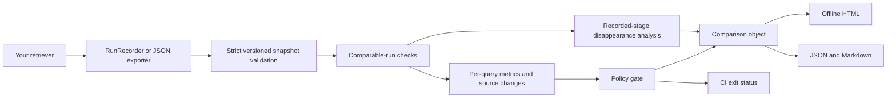

# Architecture and decisions

## Data flow

The application is a Python library and CLI. It does not host a service. Parsing,
comparison, and reporting are separate modules; integrations can use the SDK
without launching the CLI. The HTML template is packaged with the wheel.

## Decisions

1. **Start with document identity.** Stable source IDs survive re-chunking better
   than chunk IDs. This makes source-level comparison useful quickly, but cannot
   establish that the right passage survived. The limitation is explicit.
2. **Capture stages at the source.** Final ranked results cannot reveal a filter's
   discarded inputs. Instrumentation is required for this diagnostic value.
3. **Distinguish observation and cause.** Absence in the next recorded stage is
   observable. A precise removal reason comes only from the application. Scores
   alone never manufacture an explanation.
4. **Fail closed on comparison coverage.** Query removal, changed questions,
   changed corpus, or altered labels invalidate the comparison. Otherwise a
   failing question could disappear and make an aggregate look better.
5. **Gate each labeled query.** Averaged gains and losses can cancel. Aggregate
   scores describe the test set; they do not override per-query policy failures.
6. **Use the standard library at runtime.** A portable report does not need a
   database, hosted service, JS build chain, or model connection. This reduces
   setup friction. It also leaves large-data streaming and collaboration out of
   the first release.
7. **Render untrusted text as text.** Embedded JSON escapes `<`; UI fields use
   `textContent`, never `innerHTML`. CSP disallows network connections, forms,
   and external resources. Browser tests include a closing-script payload.

## Complexity

For a pair of query traces, comparison scans recorded hits and uses sets for
source presence. Disappearance analysis currently scans the stages for each
missing target document: O(H × L), where H is recorded hits and L is the number
of lost or labeled-missing document targets. This is acceptable for bounded
per-query traces, not a large-scale guarantee. A reverse document→last-stage
index is the next optimization if measured workloads justify it.

Input snapshots, comparison objects, and rendered HTML are held in memory. The
comparison object deliberately contains both traces so report review works
offline. Payload size and rendering costs grow with recorded excerpt length.
Do not call this a distributed or production-scale system yet.

## Extension points

- Add schema-versioned passage anchors with explicit source-version handling.
- Add format adapters that preserve IDs rather than guessing from changing text.
- Index stage evidence before adding large-query support.
- Build a streaming snapshot reader only after representative workloads exist.
- Add a service, queue, or storage layer when users need shared persistent runs.
